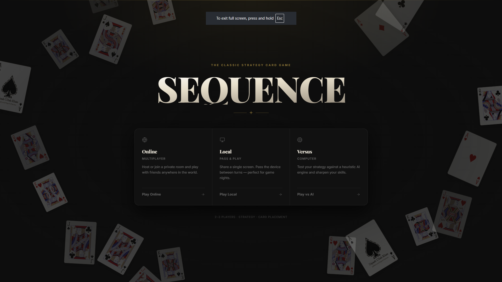
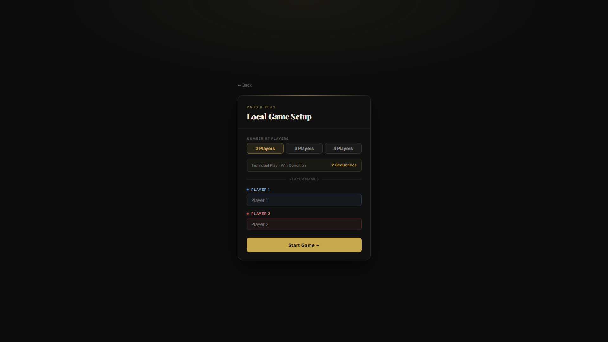
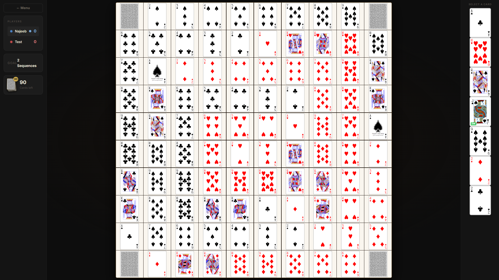
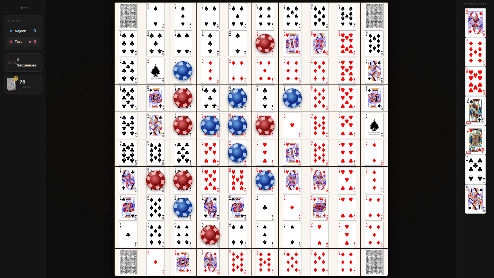
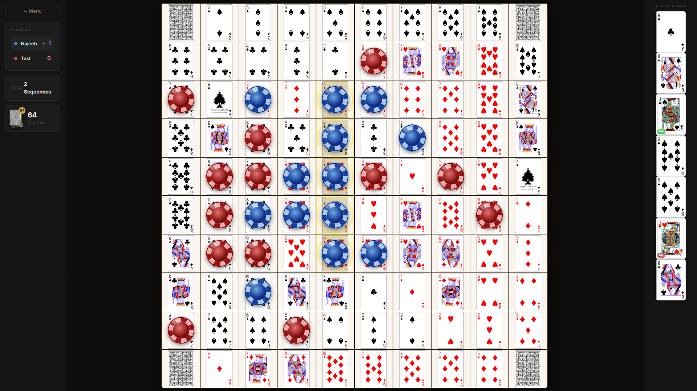
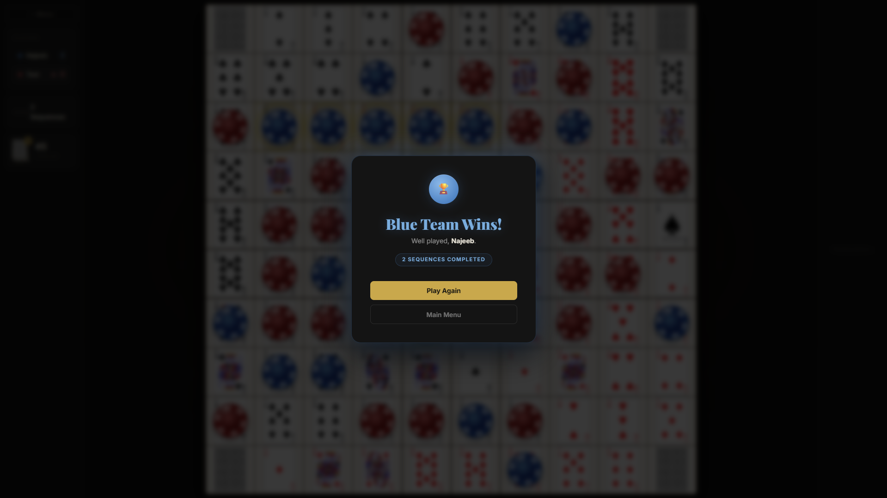

# Sequence Board Game

 

A modern, full-stack implementation of the classic **Sequence** board game. Play online with friends in custom rooms, hop into a quick match with random players, or test your skills against CPU bots with varying difficulty levels.

**🌟 Play Now:** [Live Demo](https://sequence-board-game-najeeb.vercel.app/)  
**💻 GitHub Repository:** [Source Code](https://github.com/Najeeb-Patoana/sequence_board_game)

---

## 📸 Screenshots

### 🏠 Dashboard & Gameplay UI
Get a glimpse of the sleek and modern user interface designed for an immersive gaming experience.

| Main Dashboard | Game Menu |
| :---: | :---: |
|  |  |

| Room Setup | In-Game View |
| :---: | :---: |
|  |  |

| Playing a Card | Game Over / Victory |
| :---: | :---: |
|  |  |

### 🌐 Multiplayer Experience
Seamlessly join friends or find opponents online.

| Creating a Custom Room | Waiting Lobby |
| :---: | :---: |
|  |  |

| Join Through Link | Match Starting |
| :---: | :---: |
|  |  |

---

## ✨ Features

- **Real-Time Multiplayer**: Instantaneous gameplay and game-state synchronization using Socket.IO.
- **Custom Game Rooms**: Create a private room and share the room code with your friends to play together.
- **Quick Match**: Jump straight into the action with the 2-player auto-matchmaking queue.
- **CPU Bots**: Need an extra player? Add CPU bots with configurable difficulty levels (easy, medium, hard).
- **Session Recovery**: Built-in reconnection grace periods and session token management ensure that a temporary disconnect doesn't ruin your game.
- **Rate Limiting & Security**: Backend protection against payload bombs and event rate-limiting for fair, uninterrupted gameplay.

---

## 🛠️ Tech Stack

**Frontend**
- **React 19** (with Vite for fast bundling)
- **React Router DOM** (Navigation)
- **Socket.IO Client** (Real-time communication)
- Vanilla CSS / JSX (Responsive and aesthetic UI)

**Backend**
- **Node.js & Express**
- **Socket.IO** (WebSocket server)
- **Cors & Dotenv** (Configuration and security)

---

## 🚀 Getting Started

Follow these steps to run the project locally on your machine.

### Prerequisites

Ensure you have **Node.js** (v16+ recommended) and **npm** installed.

### 1. Clone the repository
```bash
git clone https://github.com/Najeeb-Patoana/sequence_board_game.git
cd sequence_board_game
```

### 2. Backend Setup
Navigate to the `backend` directory, install dependencies, and start the server:
```bash
cd backend
npm install
npm run dev
```
*The backend server will run on port `3000` (or as defined in your `.env`).*

### 3. Frontend Setup
Open a new terminal window, navigate to the `frontend` directory, install dependencies, and start the Vite development server:
```bash
cd frontend
npm install
npm run dev
```
*The frontend will typically be accessible at `http://localhost:5173`.*

---

## 🎮 How to Play

1. **Objective**: Be the first player/team to form a connected sequence of 5 chips on the board (horizontally, vertically, or diagonally).
2. **Mechanics**: 
   - Select a card from your hand.
   - Place a chip on a corresponding space on the game board.
   - Use Jack cards strategically (some allow you to remove an opponent's chip, others act as wild cards).
3. **Dead Cards**: If you hold a card that no longer has an available space on the board, declare it dead to swap it for a new card on your turn.
4. **Winning**: Complete the required number of sequences based on the player count to secure the victory!

---

## 📂 Project Structure

```text
Sequence Game/
├── backend/            # Express server, Game logic, Socket event handlers
│   ├── server.js       # Main entry point for the backend
│   ├── gameEngine.js   # Core sequence game rules and mechanics
│   ├── botPlayer.js    # CPU AI logic
│   └── validate.js     # Input sanitization and rate-limiting
├── frontend/           # React application
│   ├── src/
│   │   ├── components/ # Reusable UI components (Board, Cards, etc.)
│   │   ├── pages/      # Route pages (HomePage, GameRoom, etc.)
│   │   └── App.jsx     # Main React application component
│   └── package.json
└── screenshots/        # Application screenshots for documentation
```

---

## 👤 Author

**Najeeb Ullah Khan**

## 📄 License

This project is licensed under the **ISC License**.
